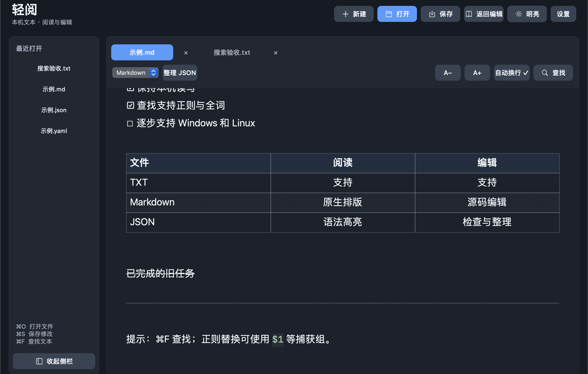
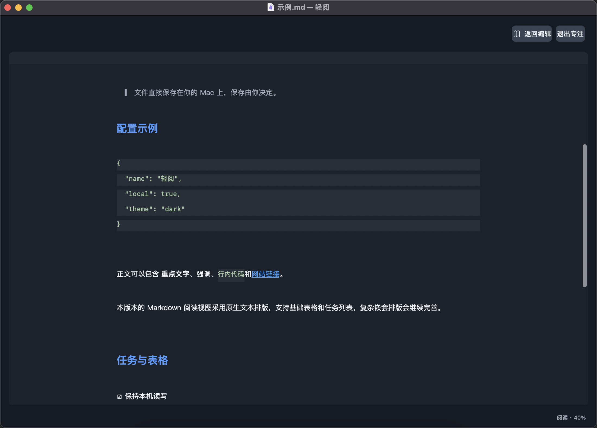

# 轻阅 Qingyue

轻量的本地文本阅读与编辑工具：打开方便、阅读舒服、修改可靠。

A lightweight local text reader and editor for macOS and Windows.

macOS 当前为 **0.1.0 · Mac 构建 4**。下载：[Mac 构建 4 体验包](https://github.com/ljy-codes/qingyue/releases/tag/macos-build-4)；[Mac 构建 3](https://github.com/ljy-codes/qingyue/releases/tag/macos-build-3)、[Mac 构建 2](https://github.com/ljy-codes/qingyue/releases/tag/macos-build-2)和[首个 0.1.0 体验包](https://github.com/ljy-codes/qingyue/releases/tag/v0.1.0)作为历史版本保留。

macOS 客户端使用 Swift、AppKit 与系统文本组件，日常文件读写在本机完成，无账号、后台服务、WebView 或第三方运行时。

Windows 当前为 **0.2.0 · 构建 2**，使用 .NET 10 + WPF，提供 x64 安装 EXE、自包含便携目录与 ZIP，
新增 TXT/Markdown 格式化、MD 分屏预览、JSON 分色与结构折叠、橙绿修改行提示，以及简化安装与真实进度；
本地构建、测试与打包命令见 [Windows 工程](开发空间/Windows/README.md)，操作差异见 [Windows 使用说明](操作指导/Windows使用说明.md)。
下方原有功能列表主要描述 Mac 版本，Windows 的已实现范围以其独立说明为准。

## 当前功能

- TXT、Markdown、JSON/JSONC、YAML、INI/CONF/CONFIG 和 XML 文本编辑。
- 普通布局中显示“文件、编辑、搜索、视图、标签、帮助”窗口菜单条，直接点击即可打开常用操作。
- 多标签、最近文件菜单、快速打开、拖入编辑区、行号、自动换行、跳转行、撤销与重做。
- 顶部侧栏开关在收起侧栏后仍可使用；标签支持双击或右键重命名。
- 会话恢复标签顺序、当前标签、阅读模式和内容位置；已保存文件重新读取磁盘，未保存草稿独立恢复。
- 草稿管理提供全局开关、当前文档排除与清理；不可变快照在后台串行写入。
- 保存全部、关闭全部，以及标签移动与排序。
- 查找替换支持大小写、正则、全词、匹配计数与高亮，以及正则捕获组替换。
- 阅读模式内查找和目录导航，保持阅读模式；源文与阅读视图采用块级对应，便于切换时继续处理同一段内容。
- 正文版心和专注布局；TXT/Markdown 侧重正文排版，JSON/YAML/配置等文本保留等宽缩进与高亮。
- Markdown 标题、列表、任务列表、删除线、代码、链接和基础表格的原生阅读。
- 阅读与编辑外观设置、系统外观跟随、位置记忆；每个文件可保留自己的阅读/编辑模式。
- 标签切换快捷键与右键文件操作，复制路径、在 Finder 中显示；窗口位置记忆，关闭窗口与退出应用分开。
- Tab / Shift+Tab 整行缩进，换行继承缩进。
- JSON 检查与保留数字原始精度的格式化；JSONC 支持注释和尾逗号检查。
- UTF-8/BOM、UTF-16 LE/BE、GB18030，保留编码与换行；安全保存、外部修改冲突提示、本机恢复草稿。

完整操作和边界见[使用说明](操作指导/使用说明.md)，本轮变化见[变更记录](CHANGELOG.md)。

已保存文件重命名会修改同目录的磁盘文件名，保留当前未保存的编辑内容；新建文档可以先起名，首次保存时再选位置。同名目标不会被重命名操作覆盖。

常用入口：`⌘F` 阅读内查找，`⌘⇧O` 文档目录，`⌘⇧F` 专注，`⌘⇧[` / `⌘⇧]` 切换标签。`⌘⇧P` 快速定位已打开与最近文件，`⌘⌥S` 保存全部。关闭窗口后应用仍在运行，重启的标签恢复与未保存草稿分别管理，详见使用说明。



## 平台安排

| 平台 | 当前状态 |
| --- | --- |
| Intel Mac，macOS 13+ | 当前客户端和构建目标 |
| Apple Silicon Mac | 尚未交付原生 ARM 包，也未做实机验收 |
| Windows x64 | 已实现 WPF 客户端、自包含便携包与深色安装/卸载向导；[实施记录](docs/Windows后续实现.md) |
| Linux | 后续方向，尚未实施 |

Windows 已在独立目录实现，测试与发布产物按平台记录。Mac 工程与历史验收保持原样。

## 构建与测试

Windows：在 Windows / PowerShell 7 中执行 `pwsh -File 开发空间/Windows/scripts/test.ps1`，
再用 `pwsh -File 开发空间/Windows/scripts/publish.ps1` 生成 `交付产品/轻阅-Windows-x64/Qingyue.exe` 与 ZIP。
再用 `pwsh -File 开发空间/Windows/scripts/build-installer.ps1 -SkipPublish` 生成安装 EXE。
需要 .NET 10 SDK；安装器另需 NSIS 与 MSVC x86 工具链。自包含发布包含运行时。
安装可选位置，卸载默认保留用户信息，彻底清理需二次确认。Windows 验收见 [docs/test.md](docs/test.md)。

安装 Xcode Command Line Tools 后，在仓库根目录运行：

```bash
bash 开发空间/scripts/build.sh
bash 开发空间/scripts/test.sh
```

应用生成到 `交付产品/轻阅.app`。产品版本与构建编号读取自 `开发空间/Resources/Info.plist`：当前分别为 `0.1.0` 和 `4`。构建缓存与应用产物不提交到 Git，仓库保存源码、示例、测试与平台记录。

当前脚本编译 Intel macOS 13 目标，执行 ad-hoc 本机签名；正式 Developer ID 签名、公证及自动更新仍待后续处理。构建不会自动替换 `/Applications` 中已安装的副本。

## 范围与性能

优先保证轻量与可靠读写。单文件上限 50 MiB；超过 200,000 个 UTF-16 单元时暂停高亮与 Markdown 排版；搜索上限 5,000,000 单元，复杂正则有时间预算。安装体积与占用应以每个构建的实际验收为准，历史小文件快照不是大文档性能保证。

Markdown 仍为轻量原生排版，图片显示文字占位，不执行脚本或自动下载远程图片。原文与阅读内容的定位是块级近似，不承诺任意字符选区都精确互转。完整 CommonMark/GFM、完整 YAML 校验、多窗口、目录全局搜索、超大日志、Office 文档、云同步与插件尚未实现。

文件写回仍由用户明确保存；恢复草稿存放在本机应用支持目录，不等同于保存原文。会话只记录文件引用、标签与显示状态；草稿单独记录未写回内容，是否保留由恢复策略与关闭时的选择决定。



本轮验证细节见[Mac 构建 4 验收](docs/Mac构建4验收.md)，此前的[构建 3 验收](docs/Mac构建3验收.md)和[构建 2 验收](docs/Mac构建2验收.md)保留；Windows 的独立处理记录见[Windows后续实现](docs/Windows后续实现.md)。
