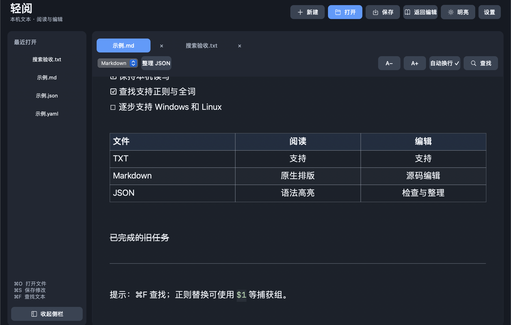

# 轻阅 Qingyue

轻量的本地文本阅读与编辑工具：打开方便、阅读舒服、修改可靠。

当前版本：

- macOS **0.4.0 · 构建 14**，Intel / Apple Silicon universal 预览包。
- Windows **0.19.0 · 构建 1**，.NET 10 + WPF 自包含 x64 客户端。

轻阅在本机完成文件读写，不要求账号或后台服务。Mac 使用 Swift、AppKit 与系统文本组件；Windows 使用 WPF 原生文本与排版组件。两端共享功能契约，界面、快捷键、文件系统、剪贴板和安装方式遵循各自平台规范。

## GitHub 分支与版本

长期分支为 `main`、`macos` 和 `windows`：

- `main`：项目基线、公共说明、功能矩阵和对齐规则。
- `macos`：Mac 原生实现、构建与验收。
- `windows`：Windows 原生实现、安装器与验收。

Mac 使用偶数次版本和偶数构建号，Windows 使用奇数次版本；标签分别为 `v<版本>-macos` 和 `v<版本>-windows`。详细规则见[跨平台版本与功能对齐规则](docs/跨平台版本与功能对齐规则.md)。

## 当前功能

- TXT、Markdown、JSON/JSONC、YAML、INI/CONF/CONFIG 和 XML 文本编辑。
- 多标签、最近文件、快速打开、拖入打开、标签排序、重命名和保存全部。
- 阅读模式、源码编辑、Markdown 分屏预览、目录跳转、正文定位和阅读位置返回。
- 本地相对/绝对路径图片、内嵌 PNG、图表窗口、宽表阅读和有限离线 Mermaid 时序图/流程图。
- Markdown 段内 `<br>`、表格编辑、TSV 粘贴为表格、图片插入与资源预算保护。
- 选区图文复制、全文复制、纯文本复制、Markdown 源文复制、代码块/表格复制和自包含 HTML 导出。
- 查找替换：大小写、全词、正则、捕获组、匹配高亮、取消和替换预览；字面查找支持 5000 万 UTF-16 单元。
- 工作区、跨文件全局搜索、阅读清单、书签、批注与 Markdown/HTML 阅读简报。
- 独立设置窗口、七套外观主题、系统外观跟随、字体、行距、段距、版心和四款 1024px 应用图标。
- 会话恢复、当前文件草稿开关、草稿清理、外部修改三路处理、安全保存、编码与换行保留。
- 本地文件 ACL、只读、占用、硬链接、重解析点和原子替换保护；网络图片不下载，HTML 不执行。

完整 CommonMark/GFM、完整 YAML 校验、多窗口、Office 编辑、云同步、插件和程序内静默更新不属于当前共同交付范围。

## Windows 0.19.0

Windows 0.19.0 已按 Mac 0.4.0 的用户功能契约完成对齐，包括六组菜单、快捷键白名单、快速打开、独立设置、七套主题、全局搜索、工作区、阅读清单、批注/书签/阅读简报、图片、Mermaid、外部冲突处理、会话草稿恢复和 1024px 图标。Windows 采用平台原生设置窗口、文件对话框、资源管理器定位和 Ctrl 快捷键，不照搬 AppKit 控件。

2026-11-25 的全量自动回归退出码为 0：Release 构建 0 警告、0 错误，WPF 流程检查 984 项通过；文件、文本、编辑、Markdown、图表、阅读、图片、剪贴板、实例、外部刷新、导航、恢复、阅读体验、批注和阅读成果测试均通过。3 个符号链接用例因当前 Windows 令牌缺少 `SeCreateSymbolicLinkPrivilege` 跳过，未计为通过。

交付产物：

- `交付产品/轻阅-0.19.0-Windows构建1-x64-setup.exe`
- `交付产品/轻阅-0.19.0-Windows构建1-x64.zip`
- 本机安装位置：`D:\Program Files\Qingyue`

安装包未做 Authenticode 签名；正式外部分发前仍需代码签名。

## 安装与构建

Windows 安装包支持可选目录、覆盖安装、系统卸载登记和可选桌面快捷方式。默认卸载保留用户数据，彻底清理需要明确确认。安装包包含 .NET 10 桌面运行时。

```powershell
pwsh -File 开发空间/Windows/scripts/build.ps1
pwsh -File 开发空间/Windows/scripts/test.ps1
pwsh -File 开发空间/Windows/scripts/publish.ps1
pwsh -File 开发空间/Windows/scripts/build-installer.ps1
```

Mac 构建：

```bash
bash 开发空间/scripts/build.sh
bash 开发空间/scripts/test.sh
bash 开发空间/scripts/check-artifact.sh
```

## 资源边界

单文件上限 50 MiB；字面搜索上限 5,000 万 UTF-16 单元；Markdown 富预览正文上限 50 万 UTF-16 单元，内嵌图片另行计限。单张图片最多 8 MiB、1600 万原始像素，单边不超过 32768；单篇最多 32 张图片、32 MiB 图片数据和 4800 万解码像素。复制、HTML 导出和 Mermaid 渲染均有独立资源预算。

源文与阅读内容采用块级近似定位，不承诺任意字符选区都精确互转。分析型错误会保留原文或源码并给出可恢复提示。

## 文档

- [Windows 使用说明](操作指导/Windows使用说明.md)
- [Mac / Windows 功能对照表](docs/功能对照表.md)
- [跨平台版本与功能对齐规则](docs/跨平台版本与功能对齐规则.md)
- [Windows 工程说明](开发空间/Windows/README.md)
- [Windows 验收记录](docs/test.md)
- [变更记录](CHANGELOG.md)
- [Mac 0.4.0 方案与验收](docs/Mac0.4.0方案与验收.md)
- [Mac 构建 14 验收](docs/Mac构建14验收.md)
- [Mac 使用说明](操作指导/使用说明.md)


