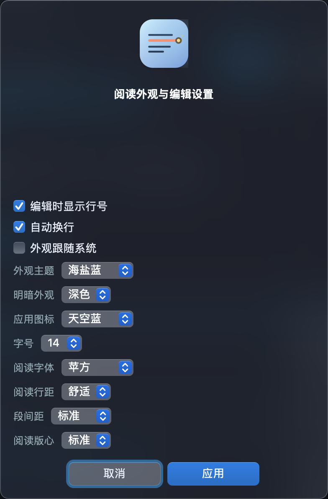

# Mac 构建 11 验收

日期：2026-11-22。产品版本 0.2.0、CFBundleVersion=11。基线为 Mac 构建 10（`feat/macos-030-parity`），本轮新增外观主题，不回退构建 10 的既有功能。

## 范围

- 保留构建 10 的分屏编辑、本地/内嵌图片、Markdown 表格编辑、Mermaid 时序图/流程图、图文复制与 HTML 导出、工作区、全局搜索、阅读清单、书签、批注、JSON 结构、格式化、修改行标记、四款应用图标等能力。
- 新增 7 套主题：经典、咖色暖读、青瓷古色、海盐蓝、烟雨紫、墨蓝深色、纸白极简。
- `ReaderTheme` 增加 `ReaderThemeID` 和 `ReaderThemeCatalog`，覆盖窗口、侧栏、主体层、编辑器、文字、次要文字、边框、强调、选区、hover、语法高亮、修改/保存标记。
- 旧 `readerTheme`（Dark/Light/WarmPaper）自动迁移到 `readerThemeID`；`ReaderTheme(dark:)` 与暖纸兼容构造保留。
- 设置增加外观主题和明暗外观，保留四款图标、阅读字体、行距、段距、版心、跟随系统。

## 自动检查

全部通过：

- FileCoreTests：32 组
- TextFeatureTests：98
- ReadingDocumentTests：331
- LineIndexTests：6147
- TextSearchTests：1038
- ThemeTests：105（7 套主题 × 明暗 token 与对比度）
- TextAnchorMapperTests：5
- BookmarkStoreTests：15
- AnnotationStoreTests：31
- WorkspaceParityTests：24
- MarkdownLinksTests：5
- MarkdownLinkRenderingTests：41
- UpdateServiceTests：16
- MarkdownTableEditingTests：205
- MarkdownAssetWriterTests：9
- ReadingMediaCacheTests：4
- MarkdownListEditingTests：150
- MermaidFlowchartTests：61
- TextEditingTests：1086
- WorkspaceStoreTests：21 组 / 102
- QuickOpenTests：35
- MermaidSequenceTests：74
- FormattingParityTests：192
- RichReadingTests：92（CLI 环境无专用粘贴板服务，其余检查通过）
- MarkdownBreakTests：58
- UIWorkflowTests：87
- WindowMenuBarTests：27
- ReaderMenusTests：42
- MacParityWorkflowTests：33
- AppearanceParityTests：67
- LayoutParityTests：115
- CurrentSyncWorkflowTests：16
- WorkspaceWindowTests：8
- ReadingListWindowTests：23
- AnnotationPanelWindowTests：13

## 构建

`bash 开发空间/scripts/build.sh` 通过，输出 `交付产品/轻阅.app`，约 3.1 MB。Info.plist 为 `CFBundleShortVersionString=0.2.0`、`CFBundleVersion=11`；ad-hoc 签名和 `codesign --verify --deep --strict` 通过。`IconThemes` 四款 PNG 已打包。

## 安装与实机验证

- 原安装副本（0.2.0，`CFBundleVersion=5`）已备份到 `交付产品/qingyue-installed-build5-backup-20261122-143350.zip`，并用 `unzip -t` 校验。
- 构建 11 已安装到 `/Applications/轻阅.app`，读取版本为 `0.2.0`、`CFBundleVersion=11`；`codesign --verify --deep --strict` 通过，`/Applications` 与 `交付产品` 的 `LightReader` SHA-256 一致。
- “关于轻阅”显示“版本 0.2.0 · Mac 构建 11 (11)”。
- 设置窗口实测：外观主题下拉包含经典、咖色暖读、青瓷古色、海盐蓝、烟雨紫、墨蓝深色、纸白极简共 7 项；明暗外观、应用图标、字号、阅读字体、阅读行距、段间距、阅读版心均在位。
- 菜单实测保留构建 10 的“打开工作区… / 全局搜索工作区… / 阅读清单… / 批注与阅读成果 / 导出自包含 HTML / JSON 工具 / Markdown 编辑 / 检查 Mac 更新…”等入口，没有回退构建 10 的功能。

## 边界

- 主题只改变显示，不改变文件编码、换行、保存策略和草稿。
- 主题对比度为 token 级自动检查；实际屏幕观感仍需人工目检。
- 配色资料来自图片 OCR；带 `?` 的色值与 10 级色阶为低置信度或示意值。
- 仍为 Intel macOS 13+、ad-hoc 本机签名；未做 Developer ID、公证和 Apple Silicon 实机验收。
