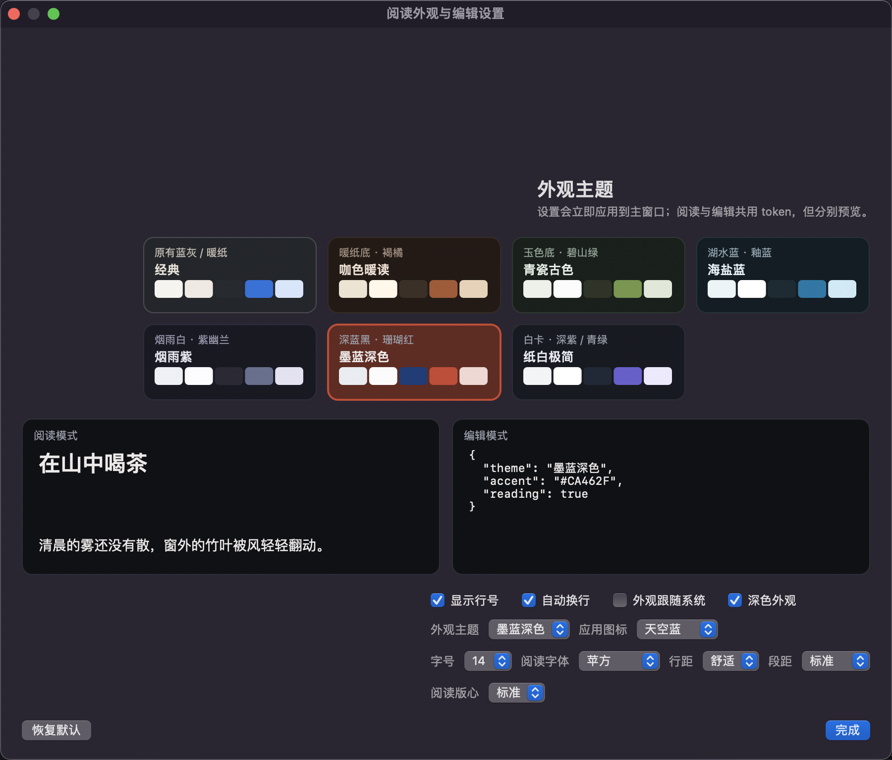

# Mac 构建 12 验收

日期：2026-11-22。产品版本 0.2.0、CFBundleVersion=12。基线为 Mac 构建 11（完整构建 10 功能 + 7 套主题），本轮处理挑刺记录中的高优先级问题。

## 本轮处理

- **大文件查找**：上限从 500 万提升到 5000 万 UTF-16 单元；普通字面查找增加 ASCII 字节快速路径，6M 级文本可直接查找；复杂正则仍保留时间预算。
- **关闭窗口保留会话**：关闭文档窗口不再 `tabs.removeAll()`，隐藏后重新打开回到原活动标签；退出应用仍执行保存/草稿/放弃确认。
- **独立设置窗口**：主窗口右上角新增“设置”按钮，“视图”菜单新增“阅读外观与设置…”；设置改为可滚动独立窗口，7 张主题卡、阅读/编辑实时预览、明暗、图标、字号、字体、行距、段距、版心即时生效。
- **深色强调色**：经典深色 accent 从 `#2F6FDB` 调整为 `#4F86F7`，对 editor `#30343A` 的对比度从约 2.63:1 提升到约 3.63:1；ThemeTests accent 门槛恢复为 3.0。
- **图标留白**：默认 AppIcon 绘制增加 5% 外边距，使可见内容更接近 macOS 图标视觉网格。
- **可访问性**：设置窗口的字号、字体、行距、段距、版心、主题、图标下拉框均补充可访问名称。

## 自动检查

完整测试套件通过：

- FileCoreTests：32 组
- TextFeatureTests：98
- ReadingDocumentTests：331
- LineIndexTests：6147
- TextSearchTests：1040（含 6M 字面查找）
- ThemeTests：107（含 accent ≥ 3.0 与旧暖纸兼容）
- TextAnchorMapperTests：5
- BookmarkStoreTests：15
- AnnotationStoreTests：31
- WorkspaceParityTests：24
- MarkdownLinksTests：5
- MarkdownLinkRenderingTests：41
- UpdateServiceTests：16
- MarkdownTableEditingTests：205
- MarkdownAssetWriterTests：9
- ReadingMediaCacheTests：4
- MarkdownListEditingTests：150
- MermaidFlowchartTests：61
- TextEditingTests：1086
- WorkspaceStoreTests：21 组 / 102
- QuickOpenTests：35
- MermaidSequenceTests：74
- FormattingParityTests：192
- RichReadingTests：93（CLI 环境无专用粘贴板服务，其余通过）
- MarkdownBreakTests：58
- UIWorkflowTests：88（新增关闭窗口保留标签断言）
- WindowMenuBarTests：27
- ReaderMenusTests：42
- MacParityWorkflowTests：33
- AppearanceParityTests：67
- LayoutParityTests：117（新增主窗口设置按钮）
- CurrentSyncWorkflowTests：16
- WorkspaceWindowTests：8
- ReadingListWindowTests：23
- AnnotationPanelWindowTests：13

## 构建与安装

- `bash 开发空间/scripts/build.sh` 通过，输出 `交付产品/轻阅-macOS-0.2.0/轻阅.app`，并生成 `SHA256SUMS.txt` 与 `轻阅-macOS-0.2.0-交付.zip`。
- 安装到 `/Applications/轻阅.app`，读取 `0.2.0` / `CFBundleVersion=12`；`codesign --verify --deep --strict` 通过；安装版与交付版 `LightReader` SHA-256 一致。
- “关于轻阅”显示“版本 0.2.0 · Mac 构建 12 (12)”。
- 设置窗口实测：7 张主题卡、阅读/编辑预览、主题/图标/字号/字体/行距/段距/版心控件均存在；切换“咖色暖读”后预览与 `readerThemeID` 即时更新，再切回“墨蓝深色”恢复。
- 主窗口品牌栏实测包含“打开文件、保存、阅读/预览、专注、设置”5 个操作；设置按钮可直接打开独立窗口。

## 边界

- 大文件搜索仍为内存内查找，未做分块索引/进度条；非 ASCII 超大文本仍走 Foundation 路径，可能触达时间预算。
- 主题为 7 套全局预设，没有按文档独立主题、自定义取色或主题导入。
- 图标四款 PNG 仍为 512 像素固定资源，未提供深浅/着色变体；Finder 图标固定天空蓝。
- 仍为 Intel macOS 13+、ad-hoc 签名；未做 Developer ID、公证和 Apple Silicon 实机验收。
