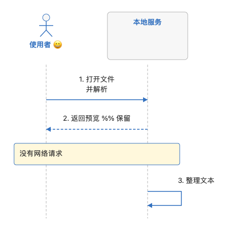

# Mac 构建 5 功能对齐与验收

日期：2026-11-10。Mac 产品版本保持 **0.1.0**，本轮构建编号 **5**。功能参照用户提供的《轻阅-功能总结-0.3.0-2026-11-10.md》和远端 Windows 0.3.0 构建 1。Windows 版本号、安装器和验收不因此变成 Mac 实现。

**状态说明：本文件先记录范围、实现边界和已实现；见下方验证范围项；最终测试、实机安装与图文粘贴结果须在实际完成后填写。未打勾项目不能表述为已验收。**

## 平台与实现边界

Mac 继续采用 Swift 5.8、AppKit/TextKit、ImageIO 和系统剪贴板，不引入 WebView、JavaScript 执行器或第三方运行时。Windows 的 WPF、NSIS、注册表和 .NET 自包含运行时不移植到 Mac；需求、文件行为和测试样例可参照。

图标使用 `开发空间/Windows/src/Qingyue.Windows/Assets/Qingyue-512.png` 作为共同源图，由 `scripts/make-icon.swift` 缩放并封装为 ICNS。Windows 的 ICO 与 Mac ICNS 格式不同，不能用文件哈希相等判断视觉一致；应核对来源和生成后尺寸/视觉。

## 功能对齐清单

| 项目 | Mac 实施范围 | 验收状态 |
| --- | --- | --- |
| Markdown 默认预览 | 首次打开进入预览，源码/预览切换；会话恢复尊重记录模式 | 已实现；见下方验证范围 |
| 分屏 | 原生 NSSplitView 左编辑右阅读，拖动调整；立即分享前同步最新正文 | 已实现；见下方验证范围 |
| 打开阶段与取消 | 读取、解析/排版、已用时间和取消入口，取消结果不加入标签 | 已实现；见下方验证范围 |
| 阅读与目录 | 目录侧栏、当前章节跟随、可见段落锚点、跳转前位置返回 | 已实现；见下方验证范围 |
| 查找位置返回 | 阅读内搜索显示文字，突出匹配、保留搜索框焦点，退出返回先前位置 | 已实现；见下方验证范围 |
| 预览复用 | 同正文、类型、字体/主题等呈现键时复用，外部更新与编辑后失效 | 已实现；见下方验证范围 |
| 本地图片 | 相对/绝对/file路径与URL编码，异步加载、等比缩放；拒绝自动网络读取 | 已实现；见下方验证范围 |
| 内嵌PNG | 受限 data:image/png;base64；坏图/超限明确说明 | 已实现；见下方验证范围 |
| 图片查看 | 适应、解码尺寸、缩放、复制位图、滚轮和Esc | 已实现；见下方验证范围 |
| 表格 | 原生行列、对齐、转义/代码竖线、短横分隔线、样式与宽表窗口 | 已实现；见下方验证范围 |
| 时序图 | 有限 sequenceDiagram 原生离线绘制、限额与完整源码回退 | 已实现；见下方验证范围 |
| 选区图文复制 | 仅选区，RTFD/RTF/HTML/纯文本，不扩大到全文 | 已实现；见下方验证范围 |
| 全文/源文/块复制 | 含已加载图片全文、纯文本、Markdown、当前代码与表格 | 已实现；见下方验证范围 |
| 自包含HTML | 转义文本、真实表格、内嵌PNG、20MiB限额，避免覆盖打开原文 | 已实现；见下方验证范围 |
| 图片准备 | 分享前有界等待、最多约5秒，可取消与提示缺图 | 已实现；见下方验证范围 |
| 格式化 | TXT/MD/JSON/JSONC/XML，保数字、重复字段、注释与保护块；可一次撤销 | 已实现；见下方验证范围 |
| JSON结构 | 原生只读树、对象/数组折叠，重复字段和数值词法保留 | 已实现；见下方验证范围 |
| 新类型 | 常见代码/配置扩展名识别，明确不代表完整高亮/格式化 | 已实现；见下方验证范围 |
| 修改行 | 橙色未保存、绿色本会话已保存；草稿不改变保存基线 | 已实现；见下方验证范围 |
| 外部文件更新 | 干净读盘更新，脏内容保留冲突，删除/暂不可读保留窗口正文 | 已实现；见下方验证范围 |
| 会话与草稿 | 原有独立恢复、后台快照、未加载记录保护与中断恢复不回退 | 已实现；见下方验证范围 |
| 多标签与命名 | 独立撤销、拖排序、空白双击新建、递增名避重复、双击/右键改名 | 已实现；见下方验证范围 |
| 文件打开请求 | 运行时的 Finder/命令行请求送入现有窗口，初始化排队 | 已实现；见下方验证范围 |
| 图标 | 与Windows共享蓝青书页源图，Mac各尺寸ICNS可解码 | 已实现；见下方验证范围 |

## 资源与安全预算

| 能力 | 当前目标边界 |
| --- | --- |
| 文件 | 50 MiB打开上限，编码/换行和显式保存策略保持 |
| 富阅读 | Markdown最多500,000个UTF-16单元；超限退源文只读 |
| 源码高亮 | 独立于富阅读预算，超限暂停装饰，不表示禁止读写 |
| 图片 | 每篇32张；单输入8MiB、合计32MiB；单图1600万、合计4800万像素 |
| 时序图 | 单图32k单元/1000行/20角色/200事件/2k标签，整篇12图/64k源码/400事件，另限绘图面积 |
| 表格 | 32列、1024单元格；超出保留源码 |
| 搜索 | 500万UTF-16单元，10万匹配，正则有有界中止 |
| 格式化 | 50万UTF-16单元，输出单独有限额 |
| JSON结构 | 200万单元、1万节点、128层 |
| 行修改装饰 | 200万单元、10万行，超限暂停标记而非清除文件脏状态 |
| HTML | 20MiB，受限位图内嵌，文本安全转义，不执行脚本 |

取消主要保证不采用过期结果，并尽可能停止后续工作，不承诺强制中断每个系统图像解码或文件调用。后台结果必须按文档身份和正文版本校验；关闭/切换标签后不能回填错误文档。

## 自动检查结果

- [x] 既有文件核心、编码、换行、权限、外部冲突、重命名和草稿恢复回归。
- [x] 既有菜单、侧栏、标签、搜索和窗口生命周期流程；Markdown默认预览的夹具预期需明确更新，不以删断言掩盖行为变化。
- [x] FormattingParityTests：JSONC注释/尾逗号/大数、MD保护块/XML混合正文、JSON结构与有界行差异。
- [x] MermaidSequenceTests：语法边界、箭头语义、长文字、布局/绘图预算和源码回退。
- [x] RichReadingTests：本地/中文/URL编码/内嵌PNG、坏图与预算、附件后的源文映射、表格与选区HTML/剪贴板数据。
- [x] 图文分享不修改原文或选区；分屏立即复制使用最新编辑；输出不能覆盖打开的原文件或软链接别名。
- [ ] 图片加载中变更字号、正文、标签或关闭窗口，过期结果不回填。
- [ ] 会话关闭而草稿允许、退出待写入、改名中断的保护继续有效。

测试均应使用临时文档、恢复目录和独立剪贴板，不能把夹具写进用户真实资料。常规命令为 `bash 开发空间/scripts/test.sh`；需要系统保存面板XPC的可选诊断仍与默认沙箱测试分开。

## 实机验证计划

- [ ] 从 `/Applications/轻阅.app` 打开合成图文Markdown，默认预览、编辑/返回、分屏、拖动比例、窗口与侧栏重排均正常。
- [ ] 图片点击查看/缩放/复制，坏图和网络引用有说明；大图片不无界解码。
- [ ] 目录跟随、返回位置、查找高亮/返回、字号/宽度变化和重启后继续同段。
- [ ] 宽表横向阅读、代码内竖线和右键复制当前表格/代码块。
- [ ] 选区、全文图文、纯文本和源文分别验证，不把一次全选粘贴代替局部复制检查。
- [ ] 在实际可用的富文本接收应用粘贴并核对表格、图片和末尾文字；未测试的接收方明确注明。
- [ ] 自包含HTML另存后独立打开，确认本地无额外图片目录、文字/表格/图像完整；超限或取消不产生半截产物。
- [ ] 打开阶段、取消、快速切换/关闭、脏文档外部修改等过程不丢编辑。
- [ ] 安装前处理旧进程与未保存内容，备份旧安装，核对0.1.0/构建5、签名、文件摘要及“办公与沟通”分类。

## 性能与交付记录

待执行后填写：应用本体/ZIP大小、样本字符与图片大小、首屏/呈现/分享耗时、空闲 `top MEM` 与CPU、工作峰值及取消响应。不能引用历史Mac小文件采样或Windows 619项验收作为本构建结果。

工作分支：`feat/macos-030-parity`。发布标识计划为 `macos-build-5`；保留既有Mac构建4及更早包，Windows发布记录独立。当前包仍为Intel macOS13+、ad-hoc本机签名；没有Apple公证、Apple Silicon实机、DPI/多屏、腾讯文档真实粘贴或完整输入法验收的项目，不记为通过。

## 2026-11-10 本次执行记录

- 最新基线已获取至Windows分支提交366b5cc；Mac修改在feat/macos-030-parity分支，Windows源码未修改。
- Release构建成功，0警告0错误；仍为Mac0.1.0/构建5。
- 全套脚本通过：文件32组、格式98项、阅读模型331项、行索引6147项、搜索1038项、编辑1086项、存储21组102项、快速打开35项、Mermaid74项、格式/JSON结构/行差异192项、富阅读92项、原窗口87项、菜单27/43项、新跨功能流程33项。数字包含随机断言，不等于独立用户场景覆盖率。
- 富阅读测试在正常桌面服务权限下再次执行，专用剪贴板真实写入后为93项通过；CLI沙箱下仅跳过剪贴板服务器连接，不伪称该服务通过。
- 新流程验证默认Markdown阅读、分屏两侧实际宽度、编辑后即时分享、源文/阅读选区不被全文复制改变、连续字号变化与返回、干净外更重读/脏内容保留、格式化撤销重做、PNG附件映射。
- 合成图文在真实Mac窗口中默认预览，本地PNG可见；不把前台其他应用截图当成阅读器证据。
- Windows图标源SHA256为f74253249c71a9f08d563c188001dd91af2678fc1f3a9ab42922b234e0de0a1e，Mac的ICNS直接从该同份PNG生成。
- 应用内容合计2,010,674字节（约1.92MiB），依赖macOS框架，不携带浏览器/Node/.NET运行时。本轮未测长期CPU、峰值或首屏延迟，不能沿用Windows或历史Mac采样。

接收方实际粘贴尚有边界：本次验证了HTML真实表格、强调、内嵌PNG和尾部文字，RTFD/RTF编码与系统剪贴板数据写入；**没有在Mac的Word/腾讯文档进行人工粘贴验收**，不承诺各应用像素级一致。

打开进度与取消能保证不采用取消/过期结果，在读文件、系统解码或主线程原生排版的一次调用内部，取消不承诺硬中断。Markdown仍是轻量语法子集，表格预算/图片预算与Windows可有平台实现差异，超限保留源码/占位，不静默截断源文件。

## 最终安装与单实例验证

- 已更新 `/Applications/轻阅.app`，版本0.1.0、构建5；可执行文件、Info.plist、使用说明、图标与交付包逐字节一致，`codesign --verify --deep --strict`通过。
- 启动台分类保持“办公与沟通”；旧构建4安装包留本机备份，不上传备份。
- 直接执行安装后程序并指定隔离支持目录，第二实例传入Markdown后自行退出，首实例窗口出现该文档，验证请求转发和资料目录锁；未访问用户正文。
- 新流程最终33项，新增打开取消面板和旧图片任务回填竞态回归。取消后无新标签且不改原文件，快速编辑/分屏/字号变化后只显示最新正文。
- 未进行Mac的Word/腾讯文档实际粘贴及DPI/多屏测试；未测的兼容性继续保留为未验收，而非用Windows结果替代。
