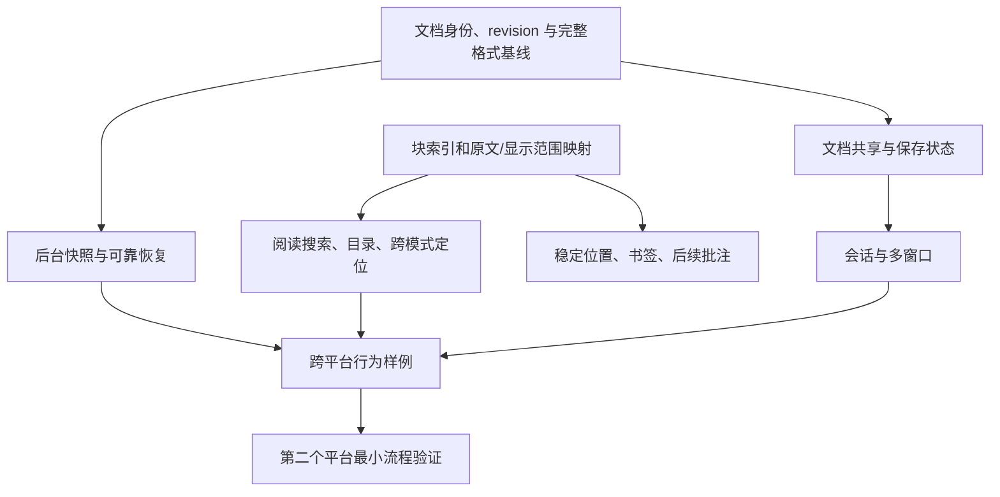

# 轻阅升级分析与路线建议

分析日期：2026-11-08。基线：轻阅 0.1.0，源码提交 `6793126`。

后续实施记录：同日已在产品版本 0.1.0 内完成 Mac 构建 2 的核心改进，实际能力与验收以[变更记录](CHANGELOG.md)和[Mac 构建 2 验收](docs/Mac构建2验收.md)为准。Windows 单独处理。

依据：[总结建议](总结建议.md)、当前源码与测试、既有验收记录，以及 Apple、Sparkle 和解析器项目的官方资料。另在临时目录复现了一例混合换行恢复后的保真边界。本文是升级决策材料，不代表下列功能已经实现，也不将过去的资源快照当作本次性能测试。

## 1. 结论：保留读写定位，先把使用过程接起来

建议定位为：**面向本机文件的轻量文本读写工具——打开方便、阅读舒服、修改可靠。**

这与最初的 TXT、Markdown、JSON、YAML、config 需求一致，也容得下后续 Windows / Linux 客户端。没有必要在“电子书阅读器”和“完整代码编辑器”之间二选一。

《总结建议》准确指出了阅读连续性、窗口行为、文件组织和草稿控制的不足。但其 P0 同时装入专注布局、版式、目录、书签、多窗口、拖动标签、文件树、目录搜索和加密，已跨越多轮迭代，不能整体视为低成本改动。EPUB、翻页动画、书库、多光标、宏也不应成为近期升级的前提。

下一次有价值的变化应该能让用户感受到：**打开一份文档，查找、跳目录、换字号、切回编辑，再打开时仍能接着处理同一段内容。**

## 2. 对原报告的核对与修正

| 原报告的判断 | 核对后的结论 | 对升级的影响 |
| --- | --- | --- |
| 阅读中查找和目录跳转会退出阅读 | 确证。`ReaderWindow.swift:631–635`、`743–747` 主动切回编辑，然后使用原文范围定位 | 是最有感知的近期改进 |
| 阅读模式只是放大字号的记事本 | 对 TXT 的评价有道理，但忽略了已实现的 Markdown 标题、表格、任务和行内排版 | 应修流程、版心和导航，而不是认定渲染必须全部推倒 |
| 历史 `refreshRecent` 崩溃仍属隐患 | 缺乏当前复发证据。现 `319` 行先加入父视图，`320` 行才激活约束，原共同祖先错误已修 | 补重复刷新回归，不能仅凭新建约束认定仍会崩溃或泄漏 |
| 编码入口容易误触 | 入口可改善，但 `607–609` 行已有转换确认，仍需保存才写回 | 改清语义与入口，保留已有防护 |
| 草稿明文，不安全 | 明文属实；同时已有 0700 目录与 0600 文件权限 | 权限保护和加密各有作用，先补开关、清理与失败处理 |
| 自绘按钮只有名字级无障碍 | 说得过满：它继承 `NSButton` 角色和动作；但绘制确实未处理禁用、焦点等状态 | 先修可证明的视觉状态，再做全键盘和 VoiceOver 实测 |
| EPUB 是阅读器必答题 | 不适用于当前文本读写范围 | 仅在实际电子书需求成立后独立评估 |
| Universal 和分发放 P3 | 对自用可以后置，对其他 Mac 用户则应提前并行准备 | 架构构建、实机验证、签名、公证分别安排 |

“没有独立朗读入口”也不等于必须从零实现语音系统。`NSTextView` 已提供开始/停止朗读接口；可以先验证系统能力和所需入口，再决定是否做语速、音色、连续章节控制。[Apple 文本视图文档](https://developer.apple.com/documentation/AppKit/NSTextView)

## 3. 比补功能清单更重要的五个发现

### 3.1 应先补一处可复现的文件保真边界

恢复记录只保存已统一为 LF 的正文和 baseline，没有保存 `originalData`（`TextFile.swift:389–432`）。通常编辑过混合换行文件时，保存会要求明确选择统一格式，这个保护仍然存在。

但以下特定路径能绕开它：

1. 打开混合换行文件，修改后生成恢复草稿。
2. 从草稿恢复，再把正文改回原 baseline，此时可以是 `isDirty == false`。
3. 磁盘文件被其他程序改动，用户明确选择覆盖原文件。
4. 因同目标、正文与编码都未变，`261` 行的 mixed 检查不执行；又因为原始字节已不存在，`272` 行重新编码时把换行统一为 LF。

临时文件探针已确认：原始 `a\r\nb\nc\r` 最后变为 `a\nb\nc\n`。超过 4 MiB、未缓存原始字节的混合换行文件，在类似“干净快照明确覆盖”场景也有这一边界。不能把它扩大为“所有恢复都会破坏文件”。

近期可先采用保守修补：**只要需要重新写入 mixed 文件而没有足够信息恢复原始换行，就必须再次让用户选择统一方式。** 之后再决定存换行分布或完整原始基线；不必为修这个边界立刻增加几十 MiB 常驻缓存。

### 3.2 阅读状态、编辑权限和专注布局需要分开

当前一个窗口级 `reading` 布尔值承担了这些含义，见 `ReaderWindow.swift:26`、`576–585`。结果是 Markdown 切阅读后，再打开 JSON 也沿用同一模式；增加隐藏工具栏、双栏、书签时，很容易继续堆条件判断。

建议明确三个独立维度：

| 维度 | 保存在哪里 | 作用 |
| --- | --- | --- |
| 展示方式：源文 / 阅读 | 每份标签的视图状态 | 决定用哪份显示内容和对应搜索坐标 |
| 编辑权限：允许修改 / 只读 | 文档或当前视图的明确策略 | 防止只读文件、预览副本被误写 |
| 布局：普通 / 专注 / 全屏 | 窗口状态 | 只决定控件显隐与正文空间 |

阅读模式可以有目录和查找，也可以保留必要工具栏；专注布局可以隐藏它们。两者不必互相绑定。

### 3.3 两类文本需要两种阅读预设

当前所有非 Markdown 内容都走同一正文阅读分支（`ReaderWindow.swift:587–598`），没有体现配置文件的结构价值。

| 文件类型 | 首要阅读价值 | 近期应做 | 避免 |
| --- | --- | --- | --- |
| TXT / Markdown | 长段文字容易读、容易回到原位置 | 居中版心、段间距、目录、阅读内搜索 | 整个窗口无限拉长行宽 |
| JSON / JSONC | 快速看清层级和值 | 等宽、高亮、键导航；先为标准 JSON 提供只读排版视图 | 为了“好看”自动改写原文件 |
| YAML / INI / config | 缩进、注释、配置节可辨认 | 保留源文布局、节导航；有真实解析器后再深化结构 | 用普通正文比例字体掩盖缩进，或解析后随意重排 |

标准 JSON 可以复用现有保留数字原始写法的格式化能力生成**显示副本**，原文件和撤销栈保持原状态。JSONC 注释、YAML 锚点等则需要更谨慎的语法模型。

### 3.4 新建和另存后，自动类型识别没有闭环

`ReaderTab` 初始化时检测类型，但 `saveCurrent` 保存到新扩展名后没有重新判断（`ReaderWindow.swift:10–12`、`416–442`）。因此新文件保存为 `.md` 或 `.json` 后可能仍按纯文本工作。

需要增加“自动识别 / 用户手选”状态：路径、扩展名变化时更新自动类型；不要覆盖用户明确选定的语言。类型状态也应进入会话恢复。

### 3.5 低消耗还需要看编辑链，而不只是安装体积

已有增量行号、搜索预算是优点。但每次正文修改仍会重建全部标签（`ReaderWindow.swift:492`、`294–303`）；脏状态会比较整份 UTF-8 内容（`TextFile.swift:188–191`）；高亮对阈值内文档在主线程重跑。

此外，草稿每次防抖后，在主线程把全部脏文档的当前正文和 baseline 编码成一个 JSON（`ReaderWindow.swift:762–769`、`TextFile.swift:393–445`）。多个大文档时，这比“按钮多几种颜色”更可能形成输入停顿和内存峰值。

应优先增量更新标签标题/修改标记、按文档缓存结果、后台持久化不可变快照，并限制打开和解析并发。**把旧搜索结果丢弃，不等于旧搜索计算已经取消。**

## 4. 关键底座：位置要锚定内容，而不是像素

当前位置记忆保存路径、选区和 `scroll.y`（`ReaderWindow.swift:327–339`）。字号、窗口宽度、表格和图片变化后，同一 Y 坐标未必还是同一段。

建议将 Markdown 阅读结果逐步扩展为：

```text
ReadingDocument
  documentID + revision
  显示文本与样式
  块索引：标题、段落、列表、代码、表格
  块的原文范围 ↔ 显示范围
  资源引用与布局预算
```

第一步只做块级对应：`**重点**` 在原文中包含标记，在阅读中没有；先保证两种视图能落在同一段，再补更精细的选区对应。原文件字节、内存 UTF-16 索引、渲染范围和字形坐标是不同空间，接口必须写明单位。

三个能力可以分开交付：

- 阅读内查找：直接搜索阅读视图的可见文字，可独立先做；隐藏链接地址不应悄悄算成可见匹配。
- 阅读内目录：标题定位到渲染块，再通过映射切回对应源文。
- 位置与书签：保存内容锚点、文档版本和必要上下文，像素坐标只作辅助；无法可靠重定位时明确提示。

因此，修阅读内搜索不应被“必须先造完整解析器”拖住；书签、批注和可勾选任务则应等映射稳定后再做。批注应保存到独立的本机元数据，默认不把标记写进 JSON/YAML 等原文；附近文本也可能含敏感内容，需遵守同一隐私策略。

## 5. 建议的升级顺序

以下是能力阶段，不直接指定发行版本号。可以先在当前 0.1.0 分支补稳，再决定何时形成下一次发布。

| 阶段 | 有边界的交付范围 | 依赖与成本 | 验收闭环 |
| --- | --- | --- | --- |
| A：补稳日常操作 | mixed 保真修补、保存后自动类型、Esc 关闭查找、标签切换快捷键、复制路径/Finder 显示、禁用态、窗口位置记忆 | 多为局部改动；生命周期需联合验证 | 新建 JSON 保存后正确识别；纯键盘打开/查找/取消/切标签/保存；原文件格式不变 |
| B：连续阅读 | 版心、系统外观、专注布局、阅读内搜索与目录、源文/阅读块级映射、两类阅读预设 | 映射与视图状态是主要跨模块工作 | 找词、跳标题、改字号、切源文，始终围绕同一内容位置 |
| C：持续工作 | 最近文件菜单、快速打开、标签菜单、保存全部、会话恢复、草稿开关/清理、独立设置窗口 | 会话与恢复拆开；后台快照、revision、失败隔离 | 重启恢复标签和模式；已保存文件重新读磁盘；未保存内容可恢复且不会被旧快照覆盖 |
| D：文件与格式深度 | 按需文件树、选定目录搜索、本地图片、配置结构导航、冲突差异预览 | 文件 I/O、解析和资源预算均需取消机制 | 只搜索用户选定目录，可取消；本地图片有大小/解码限制；冲突先看差异再决定 |
| E：第二平台验证 | Windows 的最小读写/查找/阅读流程，使用相同行为样例 | 先明确平台文件与输入接口，再选共享实现 | 编码、换行、撤销、输入法、搜索语义和资源表现达标 |

Mac 双架构构建与分发流程可以并行推进，不需要等 D/E 全部结束。完整多窗口则应等共享文档模型就绪，避免同一文件出现两份独立脏缓冲区。

下一轮最建议收敛为 **A + B 的最小闭环**。不把文件夹全局搜索、多窗口、批注、EPUB 全装进去；会话恢复可在结构就绪后紧随其后。

### 下一轮可以直接采用的验收清单

1. 在 Markdown 阅读中按 ⌘F，查找、上一处/下一处、Esc，全程保持阅读模式和位置。
2. 点击阅读目录后仍是排版页面；切换源文时定位对应段落。
3. 改字号、窗口宽度、版心后，继续显示原来阅读的段落。
4. TXT/MD 使用舒适正文排版；JSON/YAML/config 显示等宽缩进与适合自身的工具。
5. ⌘W、红叉、⌘Q、关闭最后标签、重新打开窗口分别有明确行为。红叉关闭窗口与退出应用分离，同时保障未保存内容。
6. 保存为新扩展名后自动识别；用户手选类型不被覆盖。
7. mixed 恢复/覆盖的边界进入正式回归。
8. 中文输入法候选期间的 Enter/Tab/Esc，不被全局快捷键误拦截。

## 6. 文件组织要按需发生

先有最近菜单、复制路径、Finder 显示和当前已打开文件的快速定位，再做目录功能。快速打开的快捷键需与 Mac 的打印、现有标题目录快捷键一起设计，不能照搬 ⌘P 而不处理冲突。

文件树应懒加载；目录搜索只进入用户明确选定的范围，默认跳过 `.git`、构建缓存和常见依赖目录，支持显示/取消任务。不要为了“快速打开”启动常驻全盘索引。

读取已打开文件的外部变化，也应按状态处理：干净文档可重载并保留锚点；脏文档进入冲突流程。采用事件观察并处理原子替换后重新挂接，避免频繁全文件哈希轮询。

批量替换应晚于只读目录搜索：需要结果预览、文件清单、编码失败处理和备份/撤销策略，不能把当前文件的替换按钮直接扩展成对整个目录写入。

## 7. 恢复、会话和隐私应分别管理

| 数据 | 内容 | 生命周期 |
| --- | --- | --- |
| 会话 | 文件引用、标签次序、模式、内容锚点 | 正常退出后仍可保存；启动重新读取磁盘 |
| 恢复草稿 | 未写回正文、格式基线、revision、最近成功写入时间 | 按恢复策略保留；确认保存/丢弃后清理 |
| 历史与位置 | 最近文件路径和位置 | 可整体或按文档清除 |
| 书签/批注 | 用户主动创建的阅读记录 | 独立持久化，不与自动草稿混同 |

目前“清除最近”只清最近列表，位置字典还保留路径（`ReaderWindow.swift:326–332`）。新的隐私入口应明确覆盖哪些数据，清草稿也不等于删除原文件。

草稿建议先做到：开关、按文件排除、清除、容量上限、最近成功时间、损坏数据隔离与导出、删除失败可见。再引入按文档的后台快照，防止一份超限文档使所有草稿更新失败。

后台保存必须使用带 revision 的不可变快照；不能把可变 `TextFile` 直接丢给后台，也不能在旧快照落盘后把新编辑标成已保存。

加密可采用系统密码学能力与钥匙串管理密钥，但必须处理重新安装、密钥不可用、迁移及恢复失败。密钥与密文放在同一目录没有达到预期保护；加密失败后不能悄悄改存明文。当前文件权限保护仍应保留。

## 8. 性能升级：按操作预算，而非盲目抬高上限

当前限制为：打开 50 MiB；20 万 UTF-16 单元后停高亮/Markdown 排版；搜索最多 500 万单元；表格最多 32 列、1024 单元格。它们衡量的成本不同，不能只把所有上限一起放大。

20 万 UTF-16 单元约是 20 万个基本中文字符或 ASCII 字符，不等于统一的文件大小；部分 Emoji 占多个单元。当前用户可能遇到“能打开，但不能搜索”或“稍微超限就失去排版”，需要明确说明并改善过渡。

更合理的演进是限制单行长度、块复杂度、表格/图片预算和解析耗时；后台处理可取消；先显示可读内容，按块完成排版；缓存只保留活跃与最近使用的文档。只读大文件查看与完整编辑可分开评估。

不要仅为了新框架名字切换 TextKit 引擎。现有路径使用 `layoutManager`；若验证 TextKit 2，应以长文、表格、中文输入和滚动锚点做独立比较。Apple 的视口布局也要求按目标文本范围确保布局，不能假设远处的几何位置已经精确。[Apple 关于视口定位的说明](https://developer.apple.com/forums/thread/761364)

以下为**待本机校准的目标预算**，不是现有性能保证：

| 场景 | 目标与测量 |
| --- | --- |
| 100 KB / 1 MB 普通文本输入 | 输入处理主线程延迟 p95 ≤ 50 ms，观察高亮与草稿周期是否造成停顿 |
| 取消搜索 / 关闭查找 | 界面 100 ms 内响应；取消后的旧结果不可回填 |
| 小文件静止 60 秒 | 平均 CPU < 0.5%；统一使用 `top MEM` 记录内存，不与 RSS 混用 |
| 20 个小文件标签 | 先以约 150 MiB 作讨论预算，同时记录关闭后的回收趋势，再由基线确定门槛 |
| 安装体积 | 保留薄客户端；新增依赖分别报告增量和收益，不因执着 1 MiB 而承担整套解析器维护成本 |
| 大文档 | 分别记录首屏、查找、输入、恢复写入、峰值和取消延迟，不只记录“是否能打开” |

现有搜索内部预算是 0.35 秒，但测试只断言病态回溯在 5 秒内中止（`TextSearchTests.swift:67–70`）。它证明可中止，不证明所有机器严格满足 350 ms；产品响应门槛需要端到端测量。

## 9. 跨平台：先共享规则和样例，再决定共享代码

当前 Mac 界面无需重写。先围绕实际功能，把 `ReaderWindow` 中的文档状态、阅读模型、会话/恢复和命令处理逐步移出；避免为了分层而暂停全部体验改进。



可先分离的内容：搜索/替换规则、缩进规则、JSON token 解析、格式识别和测试样例。现 `TextEditing`、`TextSearch` 已以 Foundation 为主；JSON 解析却与 AppKit 渲染放在同一文件，适合拆开。

文件系统能力单独适配：Mac 的 Darwin、ACL、软硬链接与排他重命名不能直接等同于 Windows 的行为。跨平台合同至少要明确编码/BOM、换行、Unicode 偏移单位、正则方言/捕获替换、冲突含义、恢复格式与版本迁移。

同一文件的身份也不能只用路径或 inode：路径会变化，而安全原子保存会替换 inode。先建立文档登记与引用更新规则，再做多窗口共享；同一文件不能各存一套互相覆盖的脏缓冲区。

现阶段不宜仅为“以后跨平台”就迁到 Rust/FFI 或重做全部界面。先用 Windows 的窄原型验证打开、中文输入、撤销、搜索和阅读，再根据行为一致性、资源、构建与维护成本决定共享程度。

“无第三方运行时”也不意味着所有解析必须自己写。若 Markdown 语法与范围映射继续扩张，可对比 Swift Markdown/cmark-gfm；YAML 真校验可评估 Yams/LibYAML。但解析能力不等于保留注释的格式化能力，仍需单独验证；先锁定兼容 Swift 5.8/macOS 13 的版本，并测体积、性能、许可和恶意输入边界。[Swift Markdown 项目](https://github.com/swiftlang/swift-markdown)、[Yams 项目](https://github.com/jpsim/Yams)

## 10. Mac 分发应独立推进

构建脚本目前只编译 x86_64，并采用 ad-hoc 签名（`scripts/build.sh:21`、`39`）。Universal 可以在 Intel Mac 上构建，但 ARM 切片无法在这台 Intel Mac 上完成原生调试；发布验证仍需 Apple Silicon 实机。不能把“能生成双架构包”写成“已适配验证”。[Apple Universal 构建文档](https://developer.apple.com/documentation/apple-silicon/building-a-universal-macos-binary)

对外分发时，Developer ID、Hardened Runtime、时间戳和公证应形成可复现流程；公证不是 App Store 审核，本机 ad-hoc 构建也不等同于已公证分发包。[Apple 公证说明](https://developer.apple.com/documentation/security/notarizing-macos-software-before-distribution)

自动更新可以后置于可重复发布流程。先有包与源码提交对应关系、校验、版本与构建编号，再考虑 Sparkle 的 HTTPS 更新源及更新签名。即使市场版本暂时保持 0.1.0，每个对外新构建也应有递增的构建编号和可识别提交；当前固定的 `CFBundleVersion=1` 不适合未来的更新比较。[Sparkle 官方设置文档](https://sparkle-project.org/documentation/)

当前从源码构建到 `交付产品` 不会自动更新 `/Applications/轻阅.app`。安装升级流程也需明确：确认未保存内容、退出旧进程、验证新包、替换应用、重新启动，保留用户数据与稳定的 bundle ID。

## 11. 测试升级应以用户流程为单位

现有文件核心、Unicode、行索引和搜索测试有价值；大量检查数来自随机样例和重复断言，不等于数千条独立用户流程，也不等于覆盖率。

下一批应补 `ReaderWindow` / `AppDelegate` 级场景：

- 两份脏文档退出，第一份保存、第二份取消，内容与草稿状态仍正确。
- Finder 首次打开、重复打开同文件、关闭最后标签、红叉、⌘Q、重新激活。
- 阅读内搜索、零宽匹配、异步旧结果、快速切文档与模式。
- 多标签独立撤销、保存全部时部分失败、外部原位写入与原子替换。
- 中文组合输入及候选期间的 Enter/Tab/Esc；字体回退、Emoji 和组合字符。
- 草稿截断、磁盘满、权限改变、清理失败、旧版本恢复格式迁移。
- 仅用键盘和 VoiceOver 完成“打开—查找—切标签—保存—退出”。

文件安全的表述也应有边界：当前冲突检测和原子替换能减少误覆盖，但最后一次检查与 rename 之间仍有竞争窗口，不能承诺对不合作的外部写入者实现绝对事务隔离；断电耐久性也不能由普通回归推断。

## 12. 建议暂缓与保留的方向

| 方向 | 建议 |
| --- | --- |
| EPUB、书库、分页/动画、阅读统计 | 等电子书需求被实际使用证明；当前不影响文本读写定位成立 |
| 批注、划线、任务勾选 | 有用户价值，但先有稳定映射与内容锚点；任务勾选必须能最小修改原文 |
| 朗读、系统查词 | 可先试系统能力和轻量入口，避免直接做联网翻译平台 |
| PDF/HTML 导出 | 可在分享需求成立后接原生打印/导出；“不读 Office”不等于不能导出 PDF |
| 多光标、minimap、宏、插件、AI | 当前收益不足以抵消界面与维护负担，先看真实编辑任务 |
| YAML/JSONC 全格式化 | 校验与格式化分别决策，后者需保注释、顺序、数字与锚点，不能为齐全而静默改写 |
| 崩溃上报 | 本机诊断与导出先行；联网报告需用户选择且排除正文、文件路径和配置值 |

**推荐下一次升级的验收主题：阅读不中断、文本分类型、文件操作顺手。** 以格式保真修补和状态整理开路，把最常用的流程做完整，再扩展文件组织和第二个平台。
